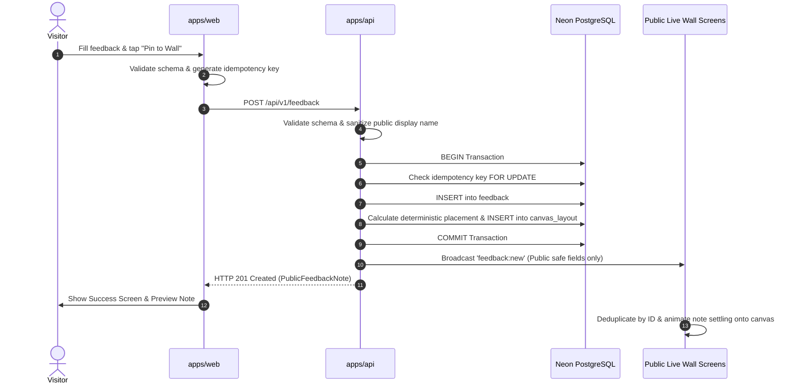

# DevBappa Solutions Live Feedback Wall — Architecture

This document describes the high-level architecture, subsystem boundaries, data flow, real-time lifecycle, and resilience guarantees of the DevBappa Solutions Live Feedback Wall built for college Tech Expos.

## 1. System Overview

The system is organized as an npm-managed monorepo with strict layer boundaries:

```mermaid
graph TD
    Client[Visitor Mobile Browser / Expo Screen Display] -->|HTTP / WebSocket| ReverseProxy[Vercel CDN / Reverse Proxy]
    ReverseProxy -->|Static Assets / SPA Routing| WebApp[apps/web (React 18 + Vite)]
    WebApp -->|REST API Requests (/api/v1)| APIApp[apps/api (Express + Node 22)]
    WebApp <-->|Socket.IO Events| APIApp
    APIApp -->|Parameterized Queries & Transactions| DB[(Neon PostgreSQL)]
    SharedPkg[packages/shared (Zod Schemas, Types, Constants)] -.-> WebApp
    SharedPkg -.-> APIApp
```

### Core Subsystems

1. **`apps/web` (Client Tier)**:
   - React 18 with TypeScript in strict mode.
   - Continuous 2D Canvas Wall: Renders physical paper sticky notes with real-time pinch-to-zoom, drag-to-pan, double-tap zoom, and spatial culling (virtualization).
   - IndexedDB Offline Queue: Durable local storage with idempotency key tracking for resilience against spotty expo WiFi.
   - Socket.IO client: Listens for authoritative broadcasts (`feedback:new`, `feedback:hidden`, `feedback:restored`, `feedback:deleted`, `stats:updated`, `canvas:layout_updated`).
   - Role-adaptive submission flow (`Student`, `Faculty`, `Other Visitor`).
   - Protected admin dashboard with real-time moderation and audit trail.

2. **`apps/api` (Server Tier)**:
   - Node.js 22 with Express and TypeScript.
   - Socket.IO server mounted on native HTTP server.
   - Transactional persistence layer: Feedback creation and deterministic canvas coordinates are committed in a single atomic transaction.
   - Secure admin authentication: HttpOnly, SameSite cookie sessions with bcrypt password hashing and rate-limiting.
   - Audit logging subsystem: Server-side tracking of moderation changes.
   - Server-side public name sanitizer and privacy firewall.

3. **`packages/shared` (Contract Tier)**:
   - Single source of truth for validation schemas (Zod).
   - TypeScript interfaces and models.
   - Business constants (field limits, predefined departments, note colors, pin variants).

---

## 2. Real-Time Event & Transaction Lifecycle

To guarantee consistency, Socket.IO broadcasts are **never emitted before a database transaction commits**:



---

## 3. Spatial Canvas Model & Virtualization

- The feedback wall operates on a **canonical 2D world coordinate plane** independent of viewport dimensions.
- Notes are clustered using a **golden angle spiral algorithm** centered around `(0, 0)` with organic jitter and rotation (-4° to +4°) persisted in PostgreSQL.
- **Adaptive Spatial Culling (Virtualization)**:
  - Only sticky notes whose bounding boxes intersect the current viewport plus a 400px pre-render buffer are rendered into the DOM.
  - Maintains 60 FPS performance on mobile devices and large 4K expo displays even with hundreds of active notes.

---

## 4. Offline Queue & Network Resilience

When network connectivity drops:
1. Validated submissions are written to local **IndexedDB** (`devbappa-offline-db`).
2. Status is set to `Queued — Waiting to sync`.
3. User is informed that feedback is saved locally and has not yet been published.
4. When `online` or `socket.reconnect` fires, `offlineQueue.processQueue()` executes:
   - Retries submission using the **same idempotency key**.
   - If server confirms acceptance, the item is removed from IndexedDB.
   - The live wall refreshes authoritative counts.
