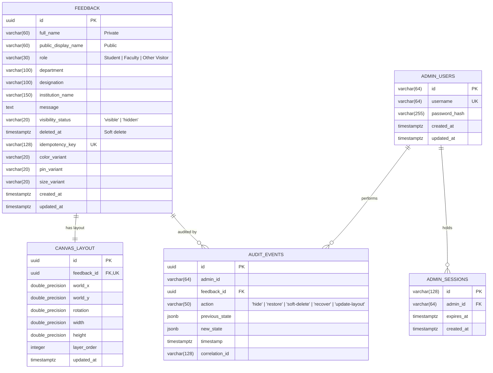

# DevBappa Solutions Live Feedback Wall — Database Specification

This document details the relational schema, constraints, migrations, indexing strategy, and Neon PostgreSQL setup.

## 1. Entity Relationship Diagram



---

## 2. Table Specifications & Indexes

### `feedback` Table
- Stores visitor submissions.
- **Privacy Firewall**: `full_name` is strictly private and never returned in public APIs. `public_display_name` is validated and derived server-side.
- **Indexes**:
  - `idx_feedback_created_at`: For ordering recent submissions.
  - `idx_feedback_public_query`: Partial index on `(created_at DESC) WHERE deleted_at IS NULL AND visibility_status = 'visible'`.
  - `idx_feedback_idempotency`: Unique index for duplicate prevention.

### `canvas_layout` Table
- Stores persistent 2D spatial arrangement on the continuous wall.
- **Indexes**:
  - `idx_canvas_layout_coords`: `(world_x, world_y)` for spatial queries.
  - `idx_canvas_layout_layer`: `(layer_order)` for z-index ordering.

### `admin_users` & `admin_sessions` Tables
- Secure server-managed session storage.
- Session expiry is checked on every protected API call via `idx_admin_sessions_expiry`.

### `audit_events` Table
- Immutable append-only audit trail for all moderation operations.

---

## 3. Migration System

Migrations are stored as ordered `.sql` files in `apps/api/src/db/migrations/`.
The migration runner:
- Creates the `_migrations` table if not present.
- Executes pending migrations sequentially inside transactions.
- Run manually with:
  ```bash
  npm run db:migrate --workspace=@devbappa/api
  ```
- Executed automatically on API startup.

---

## 4. Neon PostgreSQL Configuration

Neon connection URLs require SSL mode enabled:
```env
DATABASE_URL=postgresql://[user]:[password]@[endpoint].neon.tech/[dbname]?sslmode=require
```
The connection pool in `apps/api/src/db/index.ts` automatically detects `.neon.tech` or `sslmode=require` and enables SSL with `{ rejectUnauthorized: false }`.
